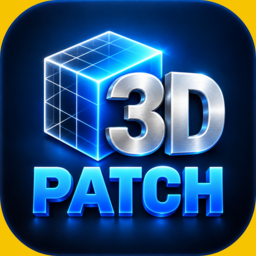

# ΩiA-Group — Alain Valette-Clary

Développements, logiciels libres et recherche · *Software, open source and research*

[LinkedIn](https://www.linkedin.com/in/alain-valette-clary-524b28352/)

## 🛠 DEV

| Projet | Description | Téléchargement |
|---|---|---|
|  [**3D-Patch**](https://github.com/OMNIA-AI-Group/3D-Patch) | Modeleur 3D pour l'impression 3D : réparation, booléens, évidement, **textures en relief & grips**, texte & images, préparation et envoi au trancheur. Rust + OpenCASCADE · Linux (AppImage, .deb, Arch) & Windows · FR/EN/ES/IT/DE · *3D modeler for 3D printing: repair, edit, relief textures & grips* |  |

Tous mes développements : [étiquette `dev`](https://github.com/OMNIA-AI-Group?tab=repositories&q=topic%3Adev) · *All my software: `dev` topic*

## 🔬 Recherche · *Research*

| Projet | Description |
|---|---|
| [**riemann-organ**](https://github.com/OMNIA-AI-Group/riemann-organ) | A stable nonlinear dynamical embodiment of the Riemann zeta zeros — The Riemann Organ |
| [**chimera-omega-goldbach**](https://github.com/OMNIA-AI-Group/chimera-omega-goldbach) | Analytic engine computing the Goldbach Resonance Index — CHIMERA Ω® (INPI DSO2025023838) |
